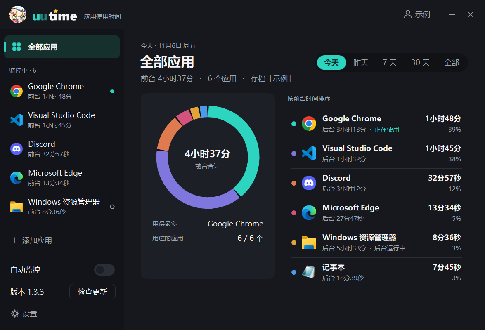
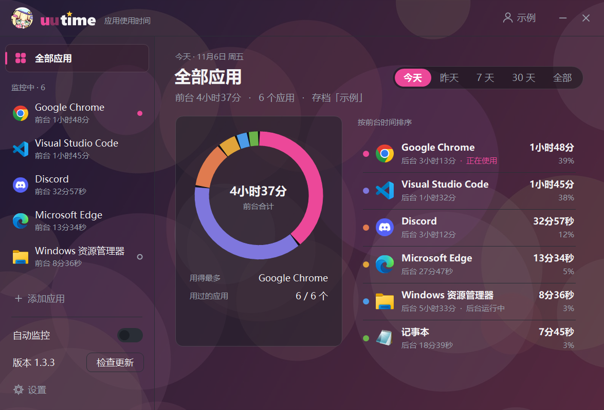
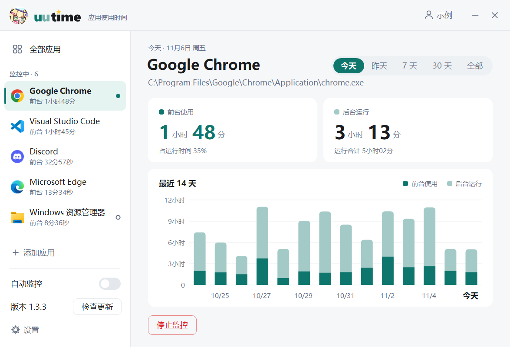
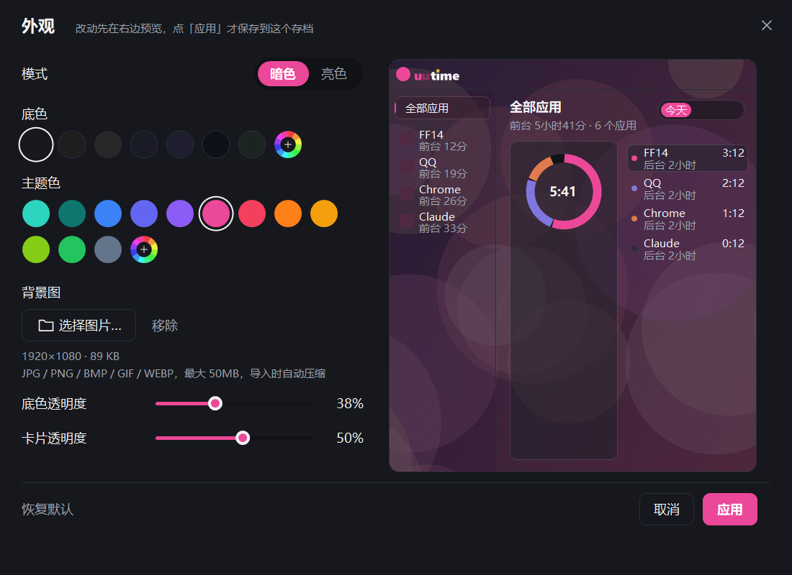
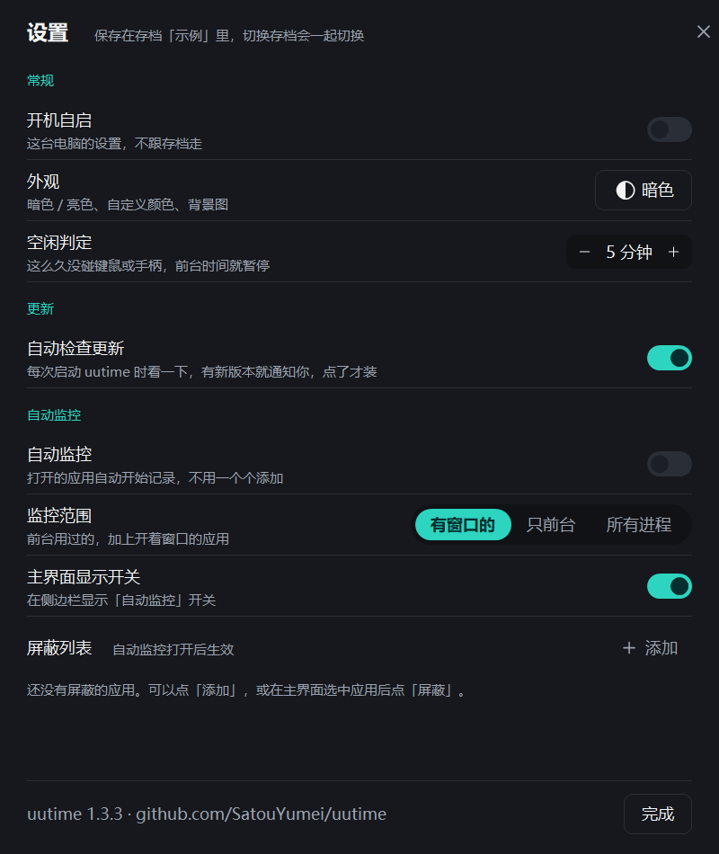

# uutime

**Windows 上的应用使用时间统计。** 常驻托盘，分开记录每个应用「在前台用了多久」和「在后台开了多久」，占用很低。



## 功能

**记录**
- **前台 / 后台分开算**：窗口在最前面、而且你在操作时算前台时间；程序开着但不在前台，或者你离开了，算后台时间。
- **空闲判定**：一段时间（默认 5 分钟，可调或关闭）没碰键盘、鼠标或手柄，前台时间就暂停。Xbox 类手柄（XInput）的操作也算在用。
- **全屏游戏也准**：除了系统的窗口切换通知，每 5 秒还会再核对一次前台窗口，不会漏记。
- **两种监控方式**：
  - 默认**只记你添加的应用**，从正在运行的程序里挑，或者直接选 exe。
  - 也可以打开**自动监控**，打开的应用会自动开始记录。范围可选「有窗口的」「只前台」「所有进程（不含系统进程）」，不想记的应用加进屏蔽列表。

**查看**
- 今天 / 昨天 / 7 天 / 30 天 / 全部，前台时间用环形图和排行显示。
- 单个应用的前台、后台时长，以及最近 14 天的柱状图。

**存档**
- 每个存档有自己的应用、记录和设置，可以改名、切换、新建、删除（会放进回收站）。
- 可以把存档**备份**成一个文件，或者从备份**导入**成新存档，不会覆盖已有的存档。

**外观**
- 暗色 / 亮色两种模式。可以自定义**底色**和**主题色**（预设色块或调色盘），其他颜色会自动搭配。
- 可以设**背景图**，底色透明度和卡片透明度都能调。导入时会自动压缩，不影响占用。
- 外观设置跟着存档走。



**其他**
- 关掉或最小化窗口后退到托盘继续记录，开机自启。
- 每次启动时检查一次新版本，有新版本就提醒，**点了才更新**。更新会显示下载进度，下载失败时会引导你去 GitHub 手动下载。

## 截图

| 单个应用（亮色） | 外观设置 |
| --- | --- |
|  |  |

| 设置 |
| --- |
|  |

## 安装

1. 到 [Releases](https://github.com/SatouYumei/uutime/releases/latest) 下载最新的 `uutime-Setup-x.y.z.exe`。
2. 运行安装。默认装在 `%LOCALAPPDATA%\Programs\uutime`，**不需要管理员权限**。
3. 需要 [.NET 10 桌面运行时](https://dotnet.microsoft.com/download/dotnet/10.0)（Windows Desktop Runtime x64）。没装的话，安装包会提示并打开下载页。

已经装过的话，点侧边栏的「检查更新」→「更新」就能升级，存档和设置都会保留。

> 安装包没有数字签名。用浏览器下载时，Windows SmartScreen 可能会提示「未知发布者」，点「更多信息」→「仍要运行」即可。

## 上手

1. 打开 uutime，点「添加应用」选要统计的程序；或者打开侧边栏的「自动监控」。
2. 关掉窗口也会继续在托盘里记录。左键点托盘图标打开主界面，右键可以退出。
3. 右上角的头像按钮是存档管理，侧边栏最下面的「设置」里有外观、空闲判定、开机自启、自动监控等。

## 数据和隐私

- 所有记录都只保存在本机的 `%LOCALAPPDATA%\uutime`，**不上传任何数据**。卸载时也会保留，方便重装后接着用。
- uutime 只记录**程序名**和**时长**，不记窗口标题、网址、文件名或屏幕内容。
- 唯一的联网行为是检查更新：访问本仓库的 Releases 页面看最新版本号，需要时下载安装包。可以在设置里关掉「自动检查更新」。

## 占用

- 前台切换靠系统事件推送，不轮询。进程状态每 5 秒扫描一次，一次约 2 毫秒。
- 托盘待机时内存很小，CPU 几乎为零。
- 主窗口和背景图只在打开窗口时占内存，关掉或最小化就释放。

## 常见问题

**连不上 GitHub，没法更新？**
点「更新」后如果下载失败，按钮会变成「去 GitHub 下载」。也可以直接在浏览器打开 [Releases](https://github.com/SatouYumei/uutime/releases) 下载新的安装包覆盖安装，存档不受影响。

**为什么看视频时前台时间不涨？**
看视频通常不碰键鼠，超过空闲判定的时间就会暂停计前台。可以在设置里调长，或者设成「不判定」。

**后台时间为什么比前台长很多？**
后台时间是程序开着但没在用的时间，比如挂在托盘里的聊天软件，一天开十几个小时很正常。各应用的后台时间是分开算的，不会互相叠加。

## 从源码编译

需要 [.NET 10 SDK](https://dotnet.microsoft.com/download/dotnet/10.0)。

```bash
dotnet build -c Release
```

打安装包还需要 [Inno Setup 6](https://jrsoftware.org/isinfo.php)，安装包输出到 `dist\`：

```bash
powershell -ExecutionPolicy Bypass -File build.ps1
```

发布新版本（版本号加一、打包、算 SHA-256、打 tag、创建 GitHub Release，安装包和 `.sha256` 一起上传，客户端更新时用它校验）：

```bash
powershell -ExecutionPolicy Bypass -File release.ps1 -Notes "更新说明"
```

开发时设置环境变量 `UUTIME_DATA` 可以把数据目录指到别处，不动真实存档。从 `bin` 运行的开发版不会自己安装更新，开机自启也用单独的 `uutime-dev`，不会影响装好的正式版。

### 代码结构

| 文件 | 内容 |
| --- | --- |
| `Tracker.cs` | 计时：前台窗口、进程扫描、空闲判定、自动监控发现新应用 |
| `Native.cs` | Win32 调用：窗口事件、进程快照、手柄输入、空闲时间 |
| `Store.cs` | 存档、设置、统计数据的读写，备份和导入 |
| `MainForm.cs` / `StatsView.cs` | 主窗口、环形图、柱状图 |
| `Theme.cs` / `AppearanceForm.cs` / `ColorPickerForm.cs` | 配色推导、外观设置、调色盘 |
| `Backdrop.cs` | 背景图导入压缩和绘制 |
| `Updater.cs` | 检查更新、下载、校验、安装 |
| `Ui.cs` | 自绘控件和无边框窗口 |
| `installer/` | Inno Setup 安装脚本 |
